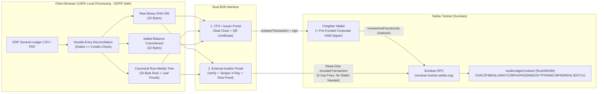

# AuditLedger - Trustless B2B Financial Audit & Soroban Merkle Notarization

> **Automated Double-Entry Reconciliation, Dual-Hash Accounting Merkle Trees, Tamper X-Ray, and Immutable Notarization on Stellar Soroban.**
>
> **HackMeridian Lisbon Submission** | **Path:** `Genesis (Idea -> MVP)` | **Track:** `Stellar Unlocked`

---

## 1. Project Summary & The B2B Problem

Corporate financial auditing faces a massive structural bottleneck: every year, companies and external audit firms (Deloitte, PwC, EY, KPMG, and statutory tax auditors) spend millions of euros and thousands of billable hours manually sampling and cross-checking exported ERP General Ledgers (`SAP`, `Oracle NetSuite`, `Holded`) just to verify that historical monthly accounting closes have not been retroactively altered.

### The Core Insight: "We Don't Stop the Initial Lie - We Eliminate the Cover-Up"

A common misconception in blockchain notarization is the **Oracle / Garbage-In Problem**: *"What if a dishonest CFO uploads a falsified balance sheet on day one?"*
AuditLedger does not claim to replace physical inventory checks or prevent a human from lying at the source. Instead, AuditLedger creates an **inescapable cryptographic trap** that solves two multi-billion-euro enterprise problems:

1. **Permanent Elimination of Retroactive Manipulation (The Cover-Up)**: In traditional cloud databases (AWS RDS, SQL Server), an administrator or CFO can silently alter January's accounting entries in November to hide a deficit before an audit. With AuditLedger, monthly closes are cryptographically frozen on **Stellar Soroban** at month-end. If a CFO seals falsified numbers in January, they are mathematically locked into that declaration forever; if they later alter a single cent to cover their tracks, the **Merkle Tamper X-Ray** exposes the exact manipulated journal row in milliseconds.
2. **80% Reduction in External Audit Verification Hours**: External auditors no longer need to spend weeks sampling document versions. They upload the client's General Ledger CSV into the **External Auditor Portal** (zero gas fees, no crypto wallet required) and receive instant mathematical certainty of ledger integrity.

---

## 2. Why `Genesis -> Stellar Unlocked`?

We chose the **Stellar Unlocked** track because we leverage **Soroban's native persistent storage, custom contract types, on-chain events, and Ed25519 authentication primitives (`issuer.require_auth()`)** to unlock a high-value traditional Enterprise B2B use case (**Trustless Corporate Auditing**) with sub-cent transaction costs and 3-5 second finality.

### Five Technical Differentiators Built During HackMeridian

| # | Innovation | Technical Problem Solved |
| :--- | :--- | :--- |
| **1** | **Dual-Hashing (`Raw Binary SHA-256` + `Canonical Accounting Merkle Root`)** | If a CFO exports a CSV on Windows (`\r\n`) and an external auditor opens and re-saves it in Excel on macOS (`\n`, padded cell whitespace) without changing a single number, a naive raw file SHA-256 fails. AuditLedger normalizes accounting rows into a deterministic canonical schema and anchors both `doc_hash` and `merkle_root` on Soroban, surviving OS/spreadsheet re-saves! |
| **2** | **Merkle Tamper X-Ray (Row-Level Pinpointing)** | When a doctored file is uploaded in the Auditor Portal, AuditLedger compares the row leaf hashes against the sealed snapshot and isolates the **exact manipulated row(s), account code(s), and EUR delta** even when the fraudster offsets Debits and Credits to keep the ledger balanced on the surface. |
| **3** | **Single-Row Zero-Leakage Merkle Proofs (`O(log N)` GDPR Privacy)** | Using our Merkle Tree engine, a company can generate a standalone cryptographic proof for **one specific journal entry** (e.g., proving a single invoice payment to a supplier or tax inspector) verified against the on-chain Soroban `merkle_root` **without revealing any other row of the balance sheet**. |
| **4** | **Salted Balance Commitments (Zero Plaintext On-Chain)** | To comply with strict European GDPR and corporate espionage protections, zero company names, zero client PII, and zero plaintext EUR amounts are ever stored on Stellar. Only three 32-byte digests (`doc_hash`, `merkle_root`, and `commitment_hash`) are written to Soroban. |
| **5** | **Printable Cryptographic Audit Certificate (With QR Matrix)** | Generates an institutional PDF/printable attestation containing the Soroban Contract ID, Transaction Hash, Authorized Signer, SHA-256, Merkle Root, and a deterministic Verification Matrix linking to `stellar.expert`. |

---

## 3. Live Stellar Testnet Deployment & On-Chain Evidence

* **Stellar Network**: `Stellar Testnet` (`Test SDF Network ; September 2015`)
* **Soroban RPC Endpoint**: `https://soroban-testnet.stellar.org`
* **Deployed Soroban Smart Contract ID (v2)**: [`CDF4JHYPUJA67S62TVWFDLV7PDDGH4H7PGN4ANUUFLLCPZNCM76VLKED`](https://stellar.expert/explorer/testnet/contract/CDF4JHYPUJA67S62TVWFDLV7PDDGH4H7PGN4ANUUFLLCPZNCM76VLKED)
* **WASM Hash**: `684f2fd260d188154e5d3ba03185081ce40fb8dbec011ff6bf628df5a170a999`
* **Contract Deployment Transaction**: [`bc3f7c540850c9e1e16d8a1d7a73c83fbaa473eb46bd91d7cae5ffb542cefb2b`](https://stellar.expert/explorer/testnet/tx/bc3f7c540850c9e1e16d8a1d7a73c83fbaa473eb46bd91d7cae5ffb542cefb2b)
* **Verified On-Chain Notarization & Auditor Co-Signature Transactions**:
  * `notarize("2026-10-SAP-GL")` (October 2026 General Ledger Close): [`c758ffaa31c32374139a58b75b3138b13dcd3fd70fcdbb75b9a47b8d46ef1fe1`](https://stellar.expert/explorer/testnet/tx/c758ffaa31c32374139a58b75b3138b13dcd3fd70fcdbb75b9a47b8d46ef1fe1)
  * `notarize("2026-09-SAP-GL")` (September 2026 General Ledger Close): [`d3780be9585007df8c2f2409e049dc31654b8f168191898e8e0fef356051a0ba`](https://stellar.expert/explorer/testnet/tx/d3780be9585007df8c2f2409e049dc31654b8f168191898e8e0fef356051a0ba)
  * `attest_audit("2026-09-SAP-GL")` (External Statutory Auditor On-Chain Co-Signature): [`aeea5a20394f2ba3874405de4d2d552dea2172b501c7d4534becb64700a58e57`](https://stellar.expert/explorer/testnet/tx/aeea5a20394f2ba3874405de4d2d552dea2172b501c7d4534becb64700a58e57)
* **Authorized CFO Testnet Wallet**: [`GCRWKUA2JLX6SMWVN5DN7MGLZS473WLSC37N6F3OM6YUX2OETIU4NRNO`](https://stellar.expert/explorer/testnet/account/GCRWKUA2JLX6SMWVN5DN7MGLZS473WLSC37N6F3OM6YUX2OETIU4NRNO)
* **External Statutory Auditor Testnet Wallet**: [`GA3NVK433AQTGR6C6B4MWWPE7O33A7WHH2C62TXXC2Y2F24A6L3AUDT`](https://stellar.expert/explorer/testnet/account/GBQWL7MV3P3UZG4KGPJ6C5U7ZVJGP474H3DS4V7EM7GBAWMCB7NQAUDT)

---

## 4. Architecture Overview



### Soroban Smart Contract (`contracts/audit-ledger/src/lib.rs`)

The smart contract implements triple-indexed persistent storage and native authentication:
* `notarize(env, issuer, period_id, doc_hash, merkle_root, commitment_hash, entry_count) -> Result<AuditRecord, AuditError>`:
  * Verifies `issuer.require_auth()`.
  * Enforces strict immutability: rejects duplicate document hashes (`HashAlreadyNotarized = 1`) and prevents overwriting an already closed period (`PeriodAlreadyClosed = 2`).
  * Stores the `AuditRecord` indexed by `DataKey::ByHash(doc_hash)`, `DataKey::ByMerkle(merkle_root)`, `DataKey::ByPeriod(issuer, period_id)`, and appends to `DataKey::History(issuer)`.
  * Publishes a Soroban event `("notarize", issuer, period_id)`.
* `get_by_hash(env, doc_hash) -> Option<AuditRecord>`
* `get_by_merkle(env, merkle_root) -> Option<AuditRecord>`
* `get_by_period(env, issuer, period_id) -> Option<AuditRecord>`
* `get_history(env, issuer) -> Vec<AuditRecord>`

---

## 5. Local Setup & Installation

### Prerequisites
* **Node.js** `>= 20.x` and `npm`
* **Freighter Wallet** browser extension (optional - the app also includes a built-in pre-funded **Corporate HSM Testnet Signer** so judges can execute real on-chain transactions in 1 click without installing extensions!)
* **Rust** & **Stellar CLI** (only if rebuilding/redeploying the Soroban contract in `contracts/audit-ledger`)

### Run the Web Application Locally

```bash
# 1. Install dependencies
npm install

# 2. Start the development server
npm run dev

# 3. Build for production
npm run build
```

### Run the Soroban Smart Contract Unit Tests & Build WASM

```bash
cd contracts/audit-ledger
cargo test
stellar contract build
```

---

## 6. Live Demo Walkthrough (For Judges)

1. **Tab 1 - CFO / Issuer Portal (`Seal Close`)**:
   * The October 2026 SAP General Ledger (`2026-10-SAP-GL`, 10 double-entry journal rows totaling `EUR 284,500.00` Debits and `EUR 284,500.00` Credits) is automatically loaded and reconciled (`0.00 EUR Delta`).
   * Inspect the three 32-byte cryptographic digests (`Raw File SHA-256`, `Canonical Accounting Merkle Root`, and `Salted Balance Commitment`).
   * Click **"Sign & Freeze Close on Stellar Soroban"** (using either the built-in pre-funded **Corporate HSM Testnet Signer** or **Freighter Wallet**).
   * Click **"Verify on Stellar.Expert"** to inspect the live transaction on Stellar Testnet, or click **"QR Certificate"** to print/export the Cryptographic Audit Certificate.
2. **Tab 2 - External Auditor Portal (`Verify & X-Ray`)**:
   * **Click 1 (`Verify Authentic Oct 2026 Close`)**: Queries the Soroban contract via read-only simulation (`0 XLM` fee, no wallet needed) and confirms **100% Bit-for-Bit + Merkle Integrity**.
   * **Click 2 (`Verify Mac/Excel Re-Saved CSV`)**: Loads a spreadsheet re-export where `\n` was changed to `\r\n` and cell whitespace was altered. Even though the Raw Binary SHA-256 changed completely, the **Canonical Accounting Merkle Root matches the Soroban contract 100%**, proving zero accounting numbers were touched!
   * **Click 3 (`Simulate +EUR 15,000 Cover-Up`)**: Loads a doctored ledger where a fraudster inflated Row #4 (`External IT Consulting`) by `+EUR 15,000.00` and offset Row #5 (`Operating Cash Credit`) by `+EUR 15,000.00` so the CSV still appears balanced (`EUR 299,500.00 == EUR 299,500.00`). AuditLedger immediately triggers a **CRITICAL RETROACTIVE MANIPULATION ALERT** and uses the **Merkle Tamper X-Ray** to highlight Row #4 and Row #5 with exact EUR deltas!
   * **Single-Row Zero-Leakage Merkle Proof Verifier**: Select any row at the bottom of the Auditor Portal to verify its `O(log N)` Merkle sibling path against the Soroban root without exposing the rest of the ledger.

---

## 7. Disclosure of Prior Work

Built entirely from scratch during the **HackMeridian Hackathon in Lisbon** (October 2026). All Soroban Rust smart contract code, client-side Web Crypto Merkle Tree & Tamper X-Ray engines, and React/TypeScript interfaces were created during the hackathon timeframe.
